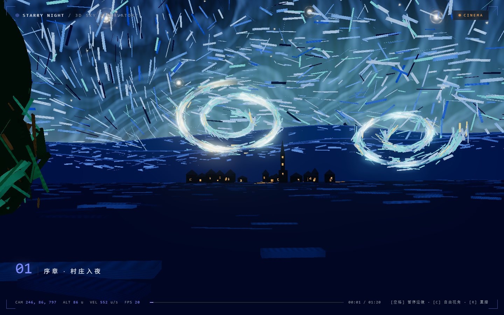

  

  # 星月夜 3D · Starry Night 3D

  把梵高《星月夜》转译为可运镜穿越的巨型 3D 空间——电影级章节运镜，也可自由视角巡游整片星空。

> 🤖 **AI 作品声明**：本项目由 supermaga 策划与验收、AI 智能体协作编码——人机共创，代码与视觉均为原创产出，非人类手写、无第三方素材。

## 亮点

- **电影运镜** —— 章节式导演运镜（「序章 · 村庄入夜」起），带实时镜头/高度/速度 HUD，随时暂停接管自由视角
- **笔触宇宙** —— 数千枚梵高笔触粒子构成星云与漩涡，整片天空实时流动
- **纯前端** —— TypeScript + Three.js（WebGL），零后端、零外部服务

## 状态

MVP 已完成，视觉持续迭代中。

> 源码暂未公开，本仓库为项目名片。

---

<small>© 2026 supermaga.top · 保留所有权利</small>
